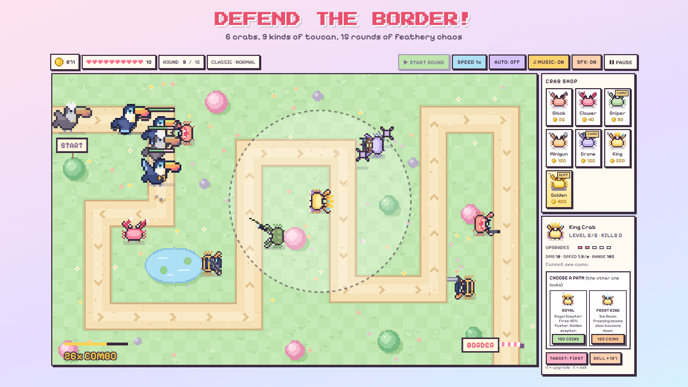

# Crabs vs Toucans

A cosy pixel-art tower defence. Place crabs, pop toucans, stop them reaching the border.

**[▶ Play in your browser](https://charliederoth.github.io/crabs-vs-toucans/)** · [Privacy policy](https://charliederoth.github.io/crabs-vs-toucans/privacy.html)

- 6 crabs with two upgrade paths each, the Golden Crab statue, and 3 heroes with skill trees
- 3 islands (9 tracks) with bosses: Toucanzilla, Toucanbot and Toucangod
- Classic (Easy / Normal / Hard), Endless, daily challenges, achievements and records
- Works offline, no ads, no tracking; colour-blind, large-text and reduced-motion options

The whole game is a single file, `index.html`, with no dependencies. Art, music and sound effects are all generated in code.

## Project layout

| Path | What |
|---|---|
| `index.html` | the game |
| `privacy.html` | privacy policy (linked from the app stores) |
| `tools/capture.js` | renders the app icons, store screenshots, feature graphic and splash sources |
| `tools/layout-audit.js` | checks every screen fits 11 device sizes without scrolling |
| `tools/balance-sim.js` | bot players that test difficulty |
| `tools/build-www.js` | copies the game into `www/` for Capacitor |
| `store/`, `screenshots/`, `assets/` | store artwork |
| `PACKAGING.md` | how to build the iOS and Android apps |

Made with Claude By Anthropic. Vibecoded by LobsterGames.

Fonts: Pixelify Sans and Press Start 2P, under the SIL Open Font License 1.1 (see `fonts/`).
